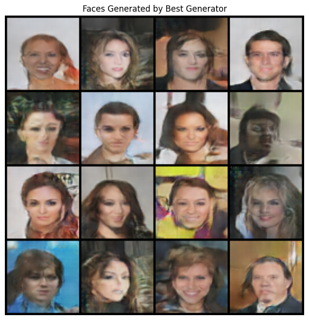
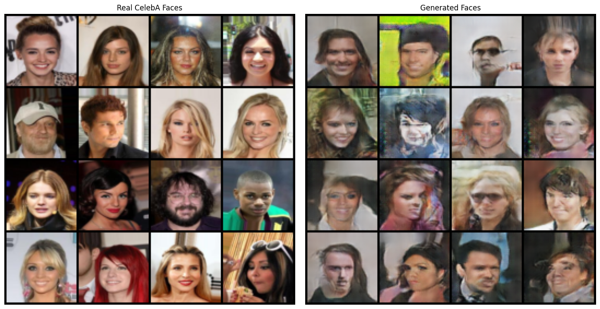
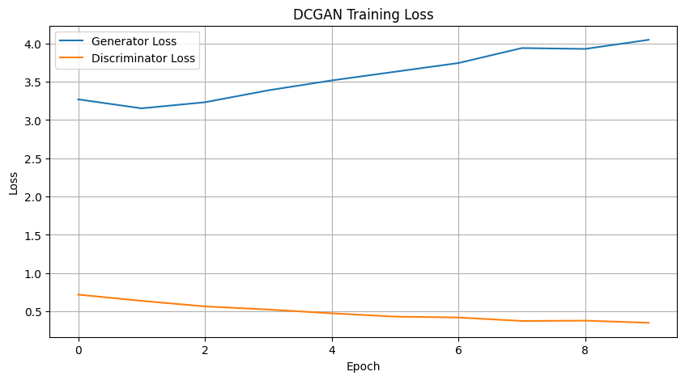

# Realistic Human Face Generation using GAN

Generates 64×64 human faces with a DCGAN trained on CelebA in PyTorch. It measures quality with FID and includes a Gradio app for generating and downloading faces.



## Dataset

[CelebA](https://www.kaggle.com/datasets/jessicali9530/celeba-dataset): **202,599** celebrity face images, resized to 64×64 and normalized to [-1, 1].

## Results

| Metric | Value |
|---|---|
| **FID** (2,000 real vs 2,000 generated images) | **50.51** |
| Generator loss, epoch 1 → 10 | 3.27 → 4.05 |
| Discriminator loss, epoch 1 → 10 | 0.72 → 0.35 |

Lower FID is better. Real CelebA faces next to generated ones:





## Approach

- **Generator:** 100-d noise vector, five transposed convolutions (512 → 256 → 128 → 64 → 3 channels), BatchNorm and ReLU, Tanh output
- **Discriminator:** five convolutions (64 → 128 → 256 → 512 → 1 channels), BatchNorm on the middle three and LeakyReLU(0.2), Sigmoid output
- **Training:** binary cross-entropy loss, Adam (learning rate 2e-4, betas 0.5 and 0.999), batch size 128, 10 logged epochs on a Tesla T4
- **Evaluation:** FID with 2048-d Inception features from `torchmetrics`

## Gradio app

- Generate 1 to 32 faces at a time
- Use a random seed, or reuse a seed to get the same faces again
- Download each face as a PNG

Demo video: [demo.mp4](demo.mp4)

## Limitations

- Images are 64×64, and some faces are blurry or distorted.
- FID was computed on only 2,000 images, so it is not comparable with scores computed on larger samples.
- The discriminator loss keeps falling while the generator loss rises, so the discriminator is getting ahead.
- The models appear to have had some training before the 10 logged epochs, so a fresh run may give different losses and FID.

## Run it

1. Open [the notebook](realistic-human-face-generation-using-gan.ipynb) on Kaggle with a GPU and internet enabled.
2. Attach the dataset above and check that `DATASET_PATH` matches.
3. Run the cells in order, with two exceptions, because the notebook was saved out of order:
   - Skip the second cell. It uses `DATASET_PATH` before it is defined, and a later cell shows the sample images.
   - Run the cells that define `EPOCHS = 10` and the optimizers **before** the two cells that print the setup and test one training step.
4. The Gradio app is the last cell with code.

To work locally, install the packages below and change the `/kaggle/...` paths. Trained weights are not included.

```bash
pip install torch torchvision torchmetrics torch-fidelity gradio matplotlib pillow tqdm numpy jupyter
```

## Structure

```
├── realistic-human-face-generation-using-gan.ipynb
├── assets/
├── demo.mp4
└── README.md
```
